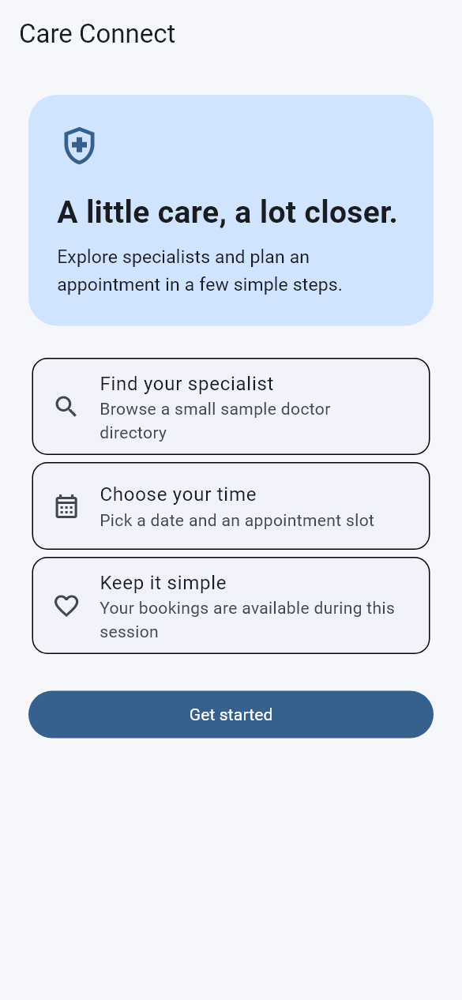

# Care Connect

## Description

Care Connect is a Flutter doctor-booking demo that takes users through onboarding, profile entry and appointment selection. Users can browse sample doctors, filter by specialty and choose a date and time for a demo appointment. It uses simple widgets, setState and Navigator.

## Preview



Mobile preview at 390 × 844 logical pixels.

## Features

- View an introductory onboarding screen.
- Enter a profile using a validated form.
- Browse sample doctor profiles and consultation fees.
- Search doctors and filter by specialty.
- Choose a doctor, appointment date and time.
- View and cancel a demo appointment.

## Built with

Flutter, Dart, Material 3, StatefulWidget, setState and Navigator.

The code uses straightforward widgets and small methods so it is easy to follow and extend. The existing Dart package name remains `project2`.

## Run locally

Use Flutter 3.47.5 / Dart 3.13.4 or a compatible newer SDK.

```bash
git clone https://github.com/YOUR_USERNAME/care-connect.git
cd care-connect
flutter pub get
flutter run
```

Run `flutter pub get` after changing Flutter versions to regenerate local package metadata. Choose a connected Android device, iOS simulator on macOS, or another supported target with `flutter devices`.

## Checks

```bash
flutter analyze
flutter test
```

## Project structure

- `lib/main.dart`: app entry point.
- `lib/ui.dart`: theme and introductory card.
- `lib/`: screens and small project-specific components.
- `test/`: smoke and behavior tests.
- `android/`, `ios/`, `web/`: platform scaffolding where generated.

## Limitations

- Doctors, fees and time slots are sample data.
- Bookings are local demonstrations and are not sent to real clinics.
- There is no backend, real authentication or payment processing.
- Profiles and appointments are kept in memory and reset when the app restarts.
- Time slots do not reflect real doctor availability.
- Native device behavior and signed release builds have not been verified.

## Validation

Checked locally with Flutter 3.47.5 / Dart 3.13.4: analysis and tests pass. Mobile previews were captured with Flutter widget rendering. Native device behavior and signed release builds have not been verified.

A small GitHub Actions workflow runs formatting, analysis and tests on pushes and pull requests. It will run after this repository is uploaded.

## License and assets

No open-source license has been selected. Existing bundled artwork is retained; verify your right to redistribute it before choosing a license. Character artwork and data, where applicable, belong to their respective owners.
